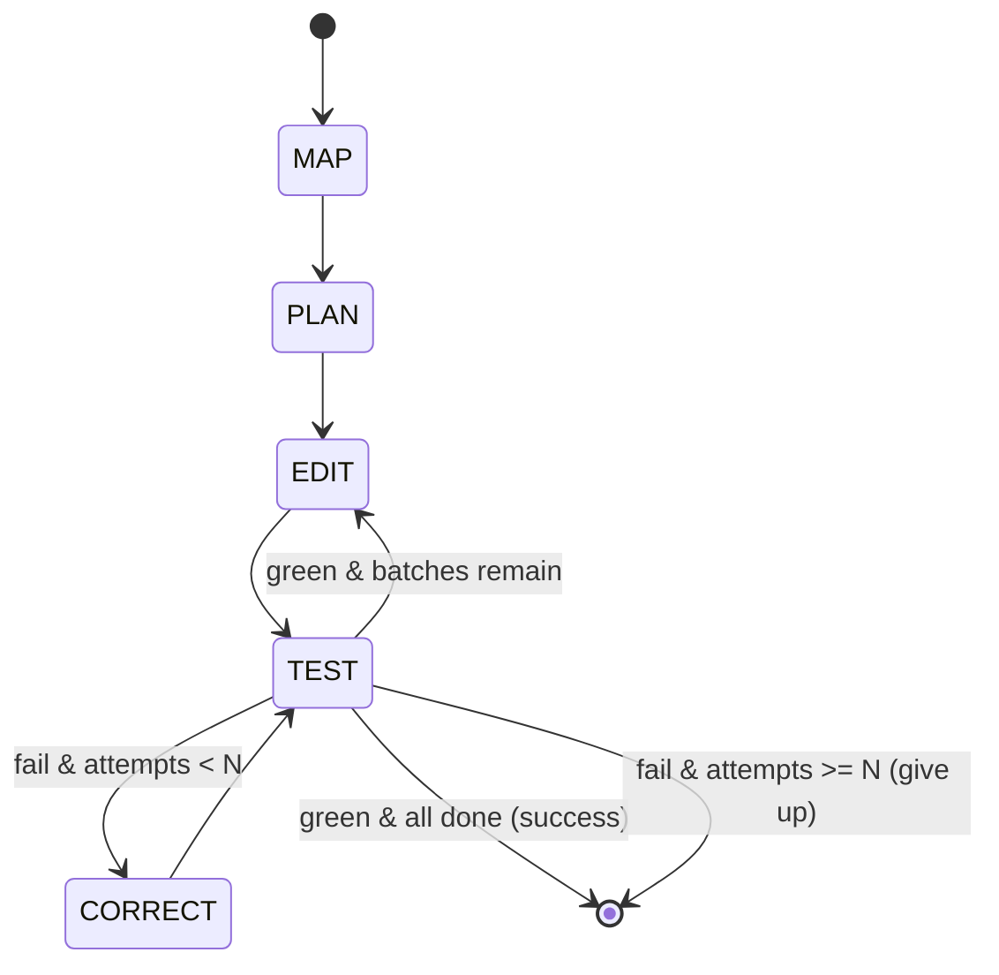

# Codebase-Wide Version Migration & Refactoring Agent (MRA)

> An autonomous agent that upgrades an entire Python codebase across a breaking library/language version change — mapping every affected call site with a dependency graph, planning a safe edit order, and running a test-driven self-correction loop until the suite passes.

**Status:** Academic major project (in development) · **Centre:** AI & ML · **Guide:** Dr Nimrita Koul · **Author:** Srinivas R C

[](https://github.com/srinivas-rc0408/Code-Base-Version-Migration-and-Refactoring-agent/actions/workflows/ci.yml)

## Run it in 30 seconds

Offline, no API key, no network: the deterministic path migrates a seven-module repo
and verifies it in the Docker sandbox (about 5 s per run after the one-time image build).

```bash
git clone https://github.com/srinivas-rc0408/Code-Base-Version-Migration-and-Refactoring-agent.git
cd Code-Base-Version-Migration-and-Refactoring-agent
uv venv --python 3.12 .venv && uv pip install --python .venv/bin/python -e '.[dev]'
#   or: python3.12 -m venv .venv && .venv/bin/pip install -e '.[dev]'
docker build -f Dockerfile.sandbox -t mra-sandbox:py312 .   # one time
env -u NVIDIA_API_KEY MRA_PRIVACY=local-only .venv/bin/mra run \
    --task-dir corpus/tierA/task04_multimodule --runs-dir /tmp/mra-demo
```

Expected: `GREEN`, `M1 recall 100.0% precision 100.0%`, `M2 100.0% (0 regressions)`,
`0 remote calls`, and a PDF report under `/tmp/mra-demo/<run_id>/`. **GREEN** means no
RED or YELLOW rule fired: among others, the suite was green before and after, no old-API
call site remains, no test file was touched, the patch applies cleanly to a fresh
checkout, there are no new ruff findings, and every edited file is exercised by a test
(exit code 0; YELLOW is 1, RED is 2; the full rules are under
[Run report and verdict](#run-report-and-verdict)).

---

## What this is

Upgrading a real codebase across a breaking change (e.g. **SQLAlchemy 1.4 → 2.0**, **Pydantic v1 → v2**) is not find-and-replace. One changed contract can break callers in many files, and some breaks are **semantic** — the code still imports but behaves differently, failing only at test time.

The MRA is a **long-horizon agent built as an explicit state machine (LangGraph 1.x)** with tools, graph-based memory, and a verification-and-recovery loop. It:

1. **MAP** — statically analyses the repo (`libcst`) and builds a dependency/call graph (`networkx`), finding every affected call site *before* editing.
2. **PLAN** — topologically orders the edits into safe batches (no circular regressions).
3. **EDIT** — applies deterministic edits as `libcst` codemods; uses an LLM only for ambiguous ones.
4. **TEST** — runs `pytest` + `ruff` inside an isolated Docker sandbox, capturing structured results.
5. **CORRECT** — on failure, parses the trace, locates the broken contract, patches it, and re-tests until green (or a retry ceiling is hit).

This is not a fancy find-replace. The **self-correction loop** and the **dependency-ordered editing** are the point.

## Architecture at a glance



Full component diagram and node contracts: [`docs/04_ARCHITECTURE_HLD_LLD.md`](docs/04_ARCHITECTURE_HLD_LLD.md).

## Tech stack

| Layer | Choice |
|---|---|
| Orchestration | LangGraph 1.x (explicit state machine) |
| State / audit log | `langgraph-checkpoint-sqlite` |
| Static analysis + codemods | `libcst` |
| Dependency graph | `networkx` |
| Verification | `pytest` + `pytest-json-report` + `ruff` |
| Git / patches | `GitPython` |
| Sandbox | Docker `python:3.12-slim` (or rootless Podman) |
| LLM providers | Any OpenAI-compatible endpoint (DeepSeek, OpenAI, GLM, or a local Ollama / vLLM / llama.cpp / LM Studio server) and Anthropic's native SDK, chosen per role in `mra.toml` — default DeepSeek V4-Pro (edits, recovery) and V4-Flash (summaries, classification); the live benchmark runs used `nvidia/nemotron-3-super-120b-a12b` via NVIDIA's API for every role |

Verified current as of Sep 2026. See [`docs/RESOURCE_PACK.md`](docs/RESOURCE_PACK.md) for versions and rationale.

## Repository structure

```
mra/
├── README.md
├── CLAUDE.md                     # instructions for AI coding assistants
├── CONFIGURATION.md              # how to set API keys & config (no secrets here)
├── .env.example                  # copy to .env and fill in (gitignored)
├── mra.example.toml              # copy to mra.toml: providers, models, role chains
├── .gitignore
├── LICENSE
├── pyproject.toml
├── Dockerfile.sandbox
├── docs/
│   ├── 01_PROJECT_CHARTER.md
│   ├── 02_LITERATURE_REVIEW.md
│   ├── 03_SRS.md
│   ├── 04_ARCHITECTURE_HLD_LLD.md
│   ├── 05_DATA_EVALUATION_PROTOCOL.md
│   ├── RESOURCE_PACK.md
│   ├── PRD.md
│   ├── Project_Explained_Simply.pdf
│   └── paper/
│       ├── paper.md              # the P5 write-up
│       └── verify_paper.py       # checks it against runs/benchmark/
├── src/mra/
│   ├── __init__.py
│   ├── state.py                  # MigrationState (see SRS §4.1)
│   ├── graph.py                  # LangGraph wiring (nodes + edges)
│   ├── nodes/
│   │   ├── map_node.py           # static analysis -> call_sites + dep_graph
│   │   ├── plan_node.py          # topological batching
│   │   ├── edit_node.py          # codemod / LLM edits
│   │   ├── test_node.py          # sandbox pytest+ruff -> test_report
│   │   └── correct_node.py       # trace parse -> patch
│   ├── analysis/                 # libcst visitors, networkx graph builder
│   ├── codemods/                 # deterministic libcst transforms (per task)
│   ├── sandbox/                  # docker run wrappers, git snapshot/rollback
│   ├── models/                   # role router, providers/, privacy, token accounting (M3)
│   ├── report/                   # evidence pass, report model, 14-page PDF (ReportLab)
│   ├── verdict.py                # GREEN / YELLOW / RED
│   └── metrics/                  # M1 + M2 computation
├── corpus/
│   ├── tierA/                    # controlled repos + ground_truth.json
│   ├── edge/                     # 39 edge-case repos + expected verdicts (RESULTS.md)
│   └── tierB/                    # real OSS repos (tagged before/gold)
├── runs/                         # per-run outputs: patch, trajectory, metrics (gitignored)
│   └── benchmark/                # ...except these four, committed because the paper
│                                 #    cites them: results.json, results.md,
│                                 #    failure-analysis.md, RESULTS_SUMMARY.md
└── tests/                        # unit tests for the agent itself
```

## Quickstart

Prerequisites: Python 3.12, Docker (or Podman). An LLM provider is optional: the
deterministic path needs none.

```bash
# 1. clone + create environment
git clone <your-repo-url> && cd mra
python -m venv .venv && source .venv/bin/activate
pip install -e ".[dev]"

# 2. configure secrets (see CONFIGURATION.md — never commit .env)
cp .env.example .env
$EDITOR .env                      # add the key(s) your providers name, e.g. DEEPSEEK_API_KEY
cp mra.example.toml mra.toml      # pick providers/models per role (or a local Ollama)
mra providers check               # reachable / WARN per provider; never fatal
mra memory stats|export|purge     # opt-in experience store (off by default)
mra skills review|approve ID|revoke ID   # verified skill promotion (human-approved)

# 3. build the sandbox image
docker build -f Dockerfile.sandbox -t mra-sandbox:py312 .

# 4. run a migration on a controlled task (analyse -> codemod -> verify -> score)
python -m mra.run --task-dir corpus/tierA/task01_datetime

# 5. or: the full agent (LangGraph) plus verdict, PDF report and terminal summary
mra run --task-dir corpus/tierA/task04_multimodule
mra report <run_id>               # rebuild a run's report from its artifacts
```

Outputs land in `runs/<run_id>/`: the unified `migration.patch`, `trajectory.json`,
`metrics.json`, and the normalized `test_report.json`.

`corpus/tierA/task04_multimodule` is the multi-batch fixture: seven modules (6 call sites), an
import cycle that has to be migrated atomically, and a break that only appears
once the batch before it lands. `python -c "from mra.graph import run_migration"`
drives it through the LangGraph state machine, checkpointing every step to
`runs/<run_id>/state.db` — which is also where `trajectory.json` comes from, since
the checkpoint history *is* the audit log rather than a copy of one.

The recovery loop is exercised by `corpus/tierA/task03_half_migration`, which is
built to be broken: migrate two of its three call sites and the suite goes red
with `TypeError: can't subtract offset-naive and offset-aware datetimes`, and
the CORRECT loop has to finish the job. Its deterministic tests need no API key
— `pytest tests/test_recovery.py` runs the whole state machine offline and skips
only the live-model case.

### Run report and verdict

`mra run` ends every run — including a crashed one — with a verdict, a PDF and a
terminal summary (exit code 0 GREEN, 1 YELLOW, 2 RED):

- **RED** — the pre-migration suite was not green (or collected no tests), the run
  crashed or gave up, the final suite has failures/errors/collection errors, a
  test file was touched, `migration.patch` fails `git apply --check` on a fresh
  checkout, or the token budget / wall-clock limit was exceeded.
- **YELLOW** — green, but: old-API sites remain (MAP re-run on the migrated tree,
  including star imports and bare references it skips by design), precision
  < 100 against ground truth, a semantic check failed, new ruff findings versus
  the pre-migration baseline (rules the target API itself triggers are exempted
  by the contract's `expected_lint` and listed as such), an unparseable file, or
  an edited file whose changed lines no test executed (coverage.py, in the sandbox).
- **GREEN** — none of the above.

`runs/<run_id>/<Repo>_MigrationReport_v<version>_<YYYYMMDD-HHMM>.pdf` is at most 14
pages (summary, repository map + dependency graph, plan, timeline, changes,
verification, metrics charts, issues with recommended actions, final banner);
overflow is cut in the order diff excerpts → timeline → file rows, and
`report.json` beside it holds everything untruncated. The report is a pure
function of the run directory (`state.db`, `verification.json`, metrics, patch),
so `mra report <run_id>` reproduces it text-for-text: the footer prints the run's
*recorded* completion time from `run_meta.json`, and only the one "Report
generated" line on page 1 carries the render time. Every page has a footer (run
id, completion time, "Page X of Y"); every page after the summary a header (repo,
contract, status pill, version). Status is always word + symbol (✓ GREEN /
! YELLOW / ✕ RED), so it survives black-and-white printing; the PDF has title,
author, subject, keywords and a bookmark per section. `NO_COLOR` disables the
terminal colours.

### Edge-case accuracy suite

`corpus/edge/` holds 39 small repos (generated by `corpus/edge/_build.py`, each with
hand-written ground truth and a passing pre-migration suite) covering common
spellings, rare syntax (f-strings, decorators, re-exports, relative imports, CRLF,
tabs, latin-1), adversarial look-alikes (strings, shadowed names, other objects'
`.utcnow()`), known gaps that must report YELLOW (bare references, star imports,
deprecated calls inside tests, unparseable files) and failure paths that must report
RED with a precise reason (red or empty baseline, network-dependent tests, hangs,
unfixable breaks, unreachable providers, local-only privacy with remote providers).
Every case asserts the *verdict* — status, reason and, where it matters, byte-exact
output — not just a green suite:

```bash
python -m mra.benchmark.edge     # writes corpus/edge/RESULTS.md and results.json
pytest tests/test_edge.py        # the same suite, one test per case
```

The latest result appears in every run report's verification table.

### LLM providers and privacy

Each LLM role (`edit`, `recover`, `summarize`, `classify`) is served by an ordered
chain of providers from `mra.toml`, falling back only when the primary errors or
times out. A local model works through its OpenAI-compatible endpoint, e.g.
Ollama at `http://localhost:11434/v1` with no key. `MRA_PRIVACY=local-only`
refuses every non-local host — including as a fallback — before any network
I/O; remote calls have secret-shaped strings redacted from the code context, and
`Router.egress` counts calls and bytes sent per remote host. Details:
[CONFIGURATION.md §3–§5](CONFIGURATION.md).

## Evaluation

Three metrics, defined formally in [`docs/05_DATA_EVALUATION_PROTOCOL.md`](docs/05_DATA_EVALUATION_PROTOCOL.md):

- **M1 — Migration Completeness** (recall / precision / F1 over affected call sites)
- **M2 — Post-Migration Test Pass Rate** (with regression count)
- **M3 — Token / Step Overhead** (tokens, tool calls, cost, normalized per call site)

## Documentation index

| Doc | Purpose |
|---|---|
| [Project Charter](docs/01_PROJECT_CHARTER.md) | Scope, targets, deliverables, timeline (the guide contract) |
| [Literature Review / SOTA](docs/02_LITERATURE_REVIEW.md) | Why existing tools/agents fall short; the research gap |
| [SRS](docs/03_SRS.md) | Functional requirements, JSON contracts, boundaries, NFRs |
| [Architecture (HLD/LLD)](docs/04_ARCHITECTURE_HLD_LLD.md) | Components, state machine, dependency-graph logic |
| [Data & Evaluation Protocol](docs/05_DATA_EVALUATION_PROTOCOL.md) | Corpus, metric formulas, sandbox setup |
| [Resource Pack](docs/RESOURCE_PACK.md) | Verified stack, migration data, reference code |
| [PRD](docs/PRD.md) | One-page problem/scope/success framing |
| [Project, Explained Simply](docs/Project_Explained_Simply.pdf) | Plain-English walkthrough of the whole system, glossary included (14 pp, PDF) |
| [Paper draft v1](docs/paper/paper.md) | The write-up of the P5 results; §1 and §3–§9 written, Abstract/§2/§10/References stubbed |
| [CLAUDE.md](CLAUDE.md) | Conventions & guardrails for AI coding assistants |

## Roadmap (build phases)

- [x] **P0** Dockerized skeleton: `pytest` + `git` wrapped as tools
- [x] **P1** Static analyzer: call sites + dependency graph (deterministic)
- [x] **P2** Single-file edit + verify (end-to-end tiny agent)
- [x] **P3** Recovery loop (the graded core): classify -> locate -> patch -> re-test, capped per failure signature
- [x] **P4** Multi-file + memory: LangGraph state machine, dependency-ordered batching, bounded context
- [x] **P5** Benchmark harness + ablations + baselines: `python -m mra.benchmark` writes
  [`runs/benchmark/results.md`](runs/benchmark/results.md), `results.json` and
  `failure-analysis.md`; the paper-ready claims live in
  [`RESULTS_SUMMARY.md`](runs/benchmark/RESULTS_SUMMARY.md)
- [ ] **P6** Tier-B external validity + paper

## Results so far (Tier A, deterministic path)

The whole matrix runs offline — the deterministic corrector stands in for the model, so
every number below is reproducible without an API key:

```bash
python -m mra.benchmark      # 5 tasks x 11 offline configs x 3 repeats = 165 runs, ~11 min
```

- **With the recovery loop:** 5/5 tasks green, M1 = 100 %, M2 = 100 %, 0 regressions.
- **Without it:** 3/5 tasks give up (M1 recall 33–67 %, 1–3 regressions each) — the loop
  is what finishes a cross-file migration, not the codemod. The two tasks that do not
  move are the controls: nothing breaks in them to begin with.
- **Batching order:** on `task05_signature_break`, with the loop off, dependency order
  finishes green while file-name order dies with a **collection error** (M2 0 %, 14
  regressions) and dependents-first order dies at call time (M2 78.6 %, 3 regressions).
  `task01`–`task04` do not separate the orders; `task05` was built because they could not.
- **ruff (DTZ) and pyupgrade:** ruff detects 100 % of the call sites and rewrites none of
  them (`DTZ003` has no autofix), so its M1 is 0 % while the suite stays green — which is
  exactly why M1 and M2 are both reported.

[`runs/benchmark/RESULTS_SUMMARY.md`](runs/benchmark/RESULTS_SUMMARY.md) states each
claim with the cells that back it; [`results.md`](runs/benchmark/results.md) has the
full matrix and the ablations, and `failure-analysis.md` itemises every run that did not
reach green.

## License

[MIT](LICENSE) — © 2026 Srinivas R C.

## Acknowledgements

Project guide: **Dr Nimrita Koul**, Centre for AI & ML. Evaluation methodology adapted from SWE-bench (Jimenez et al., 2024).
